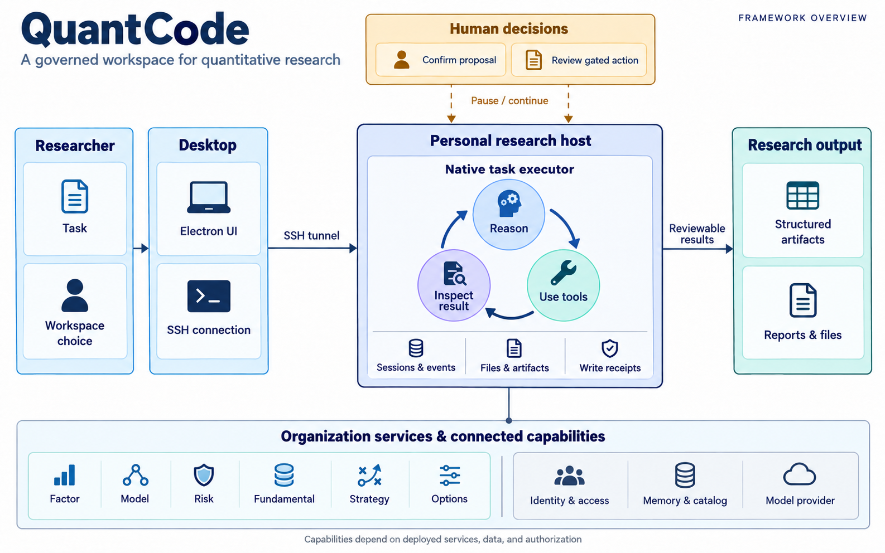
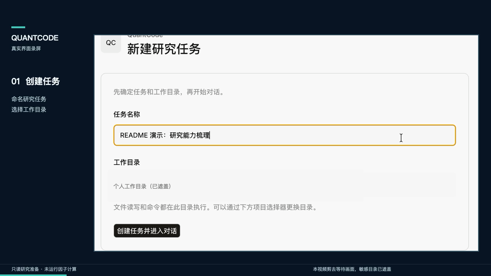
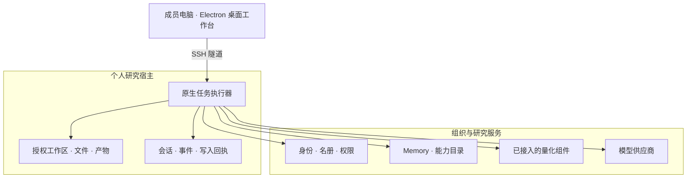
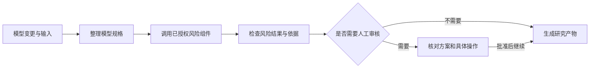

<div align="center">

# QuantCode

### 面向量化研究团队的 Agent 工作台

在授权工作区中组织研究任务、调用工具、复用知识，并审核执行过程与产物。

**中文** | [English](./README_en.md)

[演示视频](#demo) · [快速开始](#quickstart) · [系统架构](#architecture) · [技术栈](#stack) · [研究场景](#scenarios) · [开发指南](#development) · [常见问题](#faq)

[源码](https://github.com/HKUST-QUANT-SOCIETY/quantcode) · [测试版下载](https://github.com/HKUST-QUANT-SOCIETY/quantcode/releases/tag/quantcode-v1.2.0-test.5) · [构建记录](https://github.com/HKUST-QUANT-SOCIETY/quantcode/actions/workflows/quantcode-desktop.yml) · [MIT License](LICENSE)

</div>



*框架图说明任务执行关系。具体组件能力取决于服务、数据和授权；部署边界见下方架构图。*

<a id="demo"></a>
## 🎬 演示视频

[](./assets/quantcode-task-workflow-demo.mp4)

[播放 14 秒演示视频](./assets/quantcode-task-workflow-demo.mp4)：创建研究任务，调用能力目录与 Memory，查看三环节状态表，并回看执行记录。

<a id="introduction"></a>
## 📌 项目介绍

量化研究需要在代码、数据、模型、评估与团队知识之间反复切换。QuantCode 将研究任务放进有身份、工作目录和工具权限的工作区，让成员通过同一桌面入口提出任务、检查方案、执行工具，并回看文件和研究产物。

平台服务于因子、模型、风控、基本面、策略、期权，以及基建和 Agent 工作组。业务算法和数据由接入的组件提供；QuantCode 负责把任务上下文、能力发现、审批与执行记录连接起来。

### 本项目包含什么

- **桌面工作台**：任务对话、方案面板、执行记录、文件与产物入口。
- **个人研究宿主**：通过 SSH 连接，在组织开通的研究环境运行任务。
- **组织身份与授权**：组、角色和工作区由服务端身份确定。
- **能力目录与 Memory**：发现当前可用工具，查询有权访问的研究知识。
- **方案与复用审核**：检查目标、验收条件和影响文件，再继续需要审批的操作。
- **执行约束与记录**：工作区检查、预算、停止、任务历史及写入回执。
- **单仓库开发**：UI、Electron 桌面端、原生执行器和 Python 组织服务均在本仓库。

### 适合哪些读者

| 你的目的 | 建议入口 |
| --- | --- |
| 已开通账号，准备使用 | [快速开始](#quickstart) → [第一条任务](#first-task) |
| 想了解研究能力 | [研究场景](#scenarios) → [结果验证](#validation) |
| 准备参与开发 | [系统架构](#architecture) → [开发指南](#development) |
| 负责组织部署 | [身份与审批](#governance) → [文档导航](#docs) |

<a id="status"></a>
## 📦 版本与能力范围

本快照的 README 指向 **Test V1.2 / `1.2.0-test.5`**，为内部测试预发布。测试包尚未进行平台代码签名，自动更新关闭。

| 层面 | 当前说明 |
| --- | --- |
| 桌面与任务 | 提供 SSH 登录、个人工作区、组织模型、原生任务、方案审批、预算和产物入口 |
| 量化研究组件 | 因子评估、训练、回测、风控和估值依赖对应服务、数据与授权 |
| 部署要求 | 需要组织预先开通个人宿主及配套服务；安装桌面端不会自动创建这些资源 |
| 生产操作 | 普通成员不能部署到生产环境 |

`UNAVAILABLE`、`PARTIAL` 和未连接状态需要按实际依赖检查。工具出现在界面中，不代表真实业务链路已完成接入。

<details>
<summary><b>Test V1.2 最近修订</b></summary>

- `test.5`：修复 SSH 用户名记忆与工作区发现，保留已验证的服务器账号选择。
- `test.4`：补充 Windows SSH Agent 检测及启用流程。
- `test.3`：改进 SSH 入口、既有账号映射及连接异常恢复。

详见 [test.5 发布说明](docs/releases/TEST_V1_2_5.md)。

</details>

<a id="architecture"></a>
## 🧩 系统架构

### 从桌面到研究宿主



成员电脑提供交互入口，个人宿主执行研究任务。按 Test V1.2 的部署说明，Server C 的常驻服务负责身份认证、组内 Memory、任务记录和产物；实际量化能力来自已接入的组件。关闭桌面窗口后可以重新连接查看服务器任务，停止执行需要使用任务中的停止操作。

### 代码职责

| 位置 | 主要职责 |
| --- | --- |
| `frontend/packages/app/` | 研究工作区 UI |
| `frontend/packages/desktop/` | Electron 桌面壳、SSH 入口及安装包 |
| `frontend/packages/opencode/`、`frontend/packages/core/` | 原生执行器、会话、工具与底层执行能力 |
| `frontend/packages/opencode/src/quantcode/` | 身份、工作区、方案、工具准入、预算、产物及写入回执 |
| `quantcode/` | Python 组织服务与宿主接口 |
| `runner/`、`tools/`、`schemas/` | 组织规则、知识/共享状态、领域适配、契约与历史兼容代码 |

新任务使用原生执行链。Python 仍承担组织服务和必要兼容功能；旧 `AgentRunner`、LangGraph 与 checkpoint 代码的存在，不表示新桌面任务再运行一套独立 Python 推理循环。

<a id="stack"></a>
## ⚙️ 技术栈

| 层面 | 本仓库使用的技术 | 在 QuantCode 中的作用 |
| --- | --- | --- |
| 桌面端 | Electron、TypeScript | 安装包、原生窗口与桌面连接入口 |
| 工作区 UI | SolidJS、Vite、TypeScript | 任务、方案、文件与产物交互 |
| 原生宿主 | Bun、TypeScript、Effect | 会话、模型调用、工具执行及执行约束 |
| 组织服务 | Python 3.12+、Pydantic | 身份、契约、知识和组件适配 |
| 开发工具 | Bun、`uv` | 前端工作区及 Python 依赖管理 |

`pyproject.toml` 仍含 LangGraph 等依赖，用于 Python 侧现有实现与兼容路径；它不能单独证明新任务由 LangGraph 驱动。版本以 `frontend/package.json` 和 `pyproject.toml` 为准。

<a id="quickstart"></a>
## 🚀 快速开始

### 1. 准备访问条件

管理员需要先开通个人研究宿主、登记 SSH 公钥及名册权限，并配置宿主连接描述。成员准备对应的私钥文件或系统 SSH Agent 中已有的身份。

仅使用桌面安装包时，成员电脑无需另装 Python、Bun、Node.js 或另一套 OpenCode。

### 2. 下载对应平台的测试包

前往 [Test V1.2 Release](https://github.com/HKUST-QUANT-SOCIETY/quantcode/releases/tag/quantcode-v1.2.0-test.5)，同时下载 `SHA256SUMS` 和 `release-manifest.json`。

| 平台 | 文件 |
| --- | --- |
| Mac · Apple Silicon | `quantcode-1.2.0-test.5-mac-arm64.dmg` |
| Mac · Intel | `quantcode-1.2.0-test.5-mac-x64.dmg` |
| Windows 10/11 · x64 | `quantcode-1.2.0-test.5-win-x64.exe` |

Mac 将应用拖入“应用程序”；Windows 按安装向导安装到当前用户。

<details>
<summary><b>校验下载与平台提示</b></summary>

macOS：

```bash
shasum -a 256 quantcode-1.2.0-test.5-mac-arm64.dmg
```

Windows PowerShell：

```powershell
Get-FileHash -Algorithm SHA256 .\quantcode-1.2.0-test.5-win-x64.exe
```

将结果与 `SHA256SUMS` 比较。未签名测试包可能触发 Gatekeeper 或 SmartScreen；确认来源与校验值后按平台说明处理。详见 [平台安装说明](frontend/packages/desktop/QUANTCODE_INSTALL.md)。

</details>

### 3. 登录与选择工作区

1. 打开应用；没有有效会话时，点击“重新登录”。
2. 选择已登记的 SSH 身份。必要时填写原本可登录服务器的用户名。
3. 从探测结果中选择有权访问的组和实际工作区服务器。
4. 确认工作区与模型可用，再创建任务。

组织测试模型由宿主预置。个人供应商可通过模型供应商设置配置 URL、API Key 和模型。身份与模型配置是不同环节，添加模型不会获得额外工作区权限。

<a id="first-task"></a>
## 💬 完成第一条任务

在授权目录创建一个任务，输入：

> 请先读取当前项目结构，查询可用能力和组内 Memory，提出创建 `hello_quantcode.md` 的方案。说明内容、验收条件和影响文件，等我确认后再写入。完成后读回文件，并给出文件位置。

### 你应该检查什么

1. **方案**：目标明确，文件范围正确，能判断何时完成。
2. **确认**：在“任务方案与能力复用”面板查看当前版本，填写确认说明并继续执行。
3. **执行**：工具调用与原任务相关，文件位于授权工作区内。
4. **验收**：文件确实存在，读回内容与要求相符，任务记录保留结果。

继续已有任务时从任务列表打开原任务。若出现未确认的写入回执，先核对实际文件或外部证据，再决定如何处理；直接重复操作可能再次产生副作用。

<a id="scenarios"></a>
## 🔬 研究场景与组件接入

下面描述各研究方向可以组织的任务。实际可执行范围由部署环境中的组件、数据和授权决定。

| 方向 | 示例任务 | 需要核对的产物与依赖 |
| --- | --- | --- |
| 因子 | 整理因子想法、生成规格、提交评估 | 因子表达式、数据范围、评估服务及结果来源 |
| 模型 | 读取模型变更、提取结构与参数 | 模型规格、版本、训练/评估数据 |
| 风控 | 分析模型或策略风险、整理审核材料 | 指标输入、阈值、风险报告与审批依据 |
| 基本面 | 检索资料、提取财务信息、形成报告 | 来源、日期、估值假设及引用 |
| 策略 | 组合信号、组织回测、比较结果 | 回测引擎、样本区间、费用和交易假设 |
| 期权 | 组织波动率与 Greeks 分析 | 合约数据、市场时点、模型参数 |

### 示例：从模型变更到风险审核



这是一条说明性研究流程，不是本次执行记录，也不表示所有组件均已接通。正式演示应同时展示输入、配置、实际工具返回、报告和审批记录。

<a id="governance"></a>
## 🔐 身份、方案与执行约束

### 身份来自服务端

账号、组、角色及工作目录按组织登记确定。工具目录根据身份、角色和资源范围决定可见性；提示词不能改变这些授权。

### 审批绑定具体方案

方案包含目标、验收条件和文件影响。原生方案接口携带文档哈希与版本，避免把对旧方案的同意套用到已经变化的内容。审核接口属于宿主 UI，不应作为模型可调用的工具暴露。

### 写入需要可核对的结果

执行器记录写入开始、完成和核对事件。当回执缺失或不一致时，操作可能已经发生，但结果还未确认。此时需要核对原操作；不能把没有收到返回值直接当成“没有执行”。

<details>
<summary><b>开发者阅读入口</b></summary>

- [方案与版本校验](frontend/packages/opencode/src/quantcode/solution.ts)
- [工具目录与准入](frontend/packages/opencode/src/quantcode/tool-catalog.ts)
- [写入回执与结果核对](frontend/packages/opencode/src/quantcode/write-receipt.ts)

</details>

<a id="knowledge"></a>
## 🧠 Memory、共享状态与历史

| 概念 | 作用 | 使用时注意 |
| --- | --- | --- |
| Memory | 查询已授权的研究知识 | “空结果”和“服务未连接”是不同状态 |
| 能力目录 | 发现已发布、当前身份可用的能力 | 可见性和执行准入需要匹配 |
| Blackboard | 为组织工作流保存共享状态 | 共享范围需要显式控制 |
| 会话与事件 | 记录任务过程、产物和写入结果 | 新任务按原生执行机制组织 |
| 历史 checkpoint | 支持旧执行路径的兼容处理 | 不应把旧任务静默重跑成新任务 |

源码中还有知识候选生成与审核接口，其开放依赖宿主配置。任务产生的内容不应直接等同于已审核、已发布的团队知识。

<a id="development"></a>
## 🛠️ 开发指南

### 环境准备

- Git；Python **3.12+** 与 `uv`。
- Bun：仓库声明的包管理器版本为 **1.3.14**。
- 桌面构建依赖对应平台环境，打包与签名说明见文档。

### 安装和启动

```bash
git clone https://github.com/HKUST-QUANT-SOCIETY/quantcode.git
cd quantcode
uv sync --extra dev
bun run install:frontend
bun run dev:quantcode
```

Electron 开发入口：

```bash
bun run dev:desktop
```

只需这个仓库。研究宿主仍需配置组织网关、名册、公钥、工作区和已审核工具目录；启动开发服务不会自动授予成员权限。

<details>
<summary><b>端口与构建入口</b></summary>

默认后端端口 `4096`，网页端口 `4444`。冲突时可指定独立端口：

```bash
QUANTCODE_BACKEND_PORT=4196 QUANTCODE_APP_PORT=4544 bun run dev:quantcode
```

构建网页、桌面代码或当前平台安装包：

```bash
bun run build:web
bun run build:desktop
bun run package:desktop
```

这些是独立入口。生成安装包不表示已完成跨平台测试或平台签名。

</details>

### 仓库导览

```text
quantcode/
├── frontend/packages/
│   ├── app/             研究工作区 UI
│   ├── desktop/         Electron 与安装包
│   ├── opencode/        原生宿主与任务执行
│   └── core/            共享执行能力
├── quantcode/           Python 组织服务
├── runner/              规则、知识、共享状态与兼容实现
├── tools/               工具与组件适配
├── schemas/             数据契约
├── tests/               Python 测试
├── scripts/             开发、部署与检查入口
├── docs/                设计、发布与验收文档
└── specs/               功能规格
```

<a id="validation"></a>
## 🧪 测试与结果验证

Python 测试：

```bash
.venv/bin/pytest -q
```

原生执行器类型检查与测试：

```bash
cd frontend/packages/opencode
bun typecheck
bun --smol test --timeout 30000
```

验证研究任务时，还应记录：

- 使用的提交、配置、数据版本和执行身份。
- 工具是否调用真实服务，是否出现 mock、fallback 或 unavailable。
- 产物位置、关键内容和验收条件是否满足。
- 人工审核是否作用于正确版本，断连后任务与回执是否一致。

测试通过与某个真实业务服务已经接通，是需要分别验证的两件事。

<a id="faq"></a>
## ❓ 常见问题

<details>
<summary><b>安装桌面端后能直接独立运行吗？</b></summary>

当前文档描述的是组织部署模式，需要个人研究宿主和组织服务。桌面包安装完成后，还需要有效的组织访问条件。

</details>

<details>
<summary><b>我需要自己配置模型 Key 吗？</b></summary>

组织测试环境预置模型，普通成员通常无需填写 Key。使用个人供应商时，按模型设置中的字段配置。

</details>

<details>
<summary><b>登录成功，但工作组或工具不对怎么办？</b></summary>

检查实际服务器、用户名和公钥；联系管理员核对名册和能力目录。身份与工具授权不能通过对话改写。

</details>

<details>
<summary><b>确认方案后为什么仍然没有执行？</b></summary>

使用方案面板中的“继续执行”，检查预算、审批版本与错误提示。若有未知写入结果，先核对原操作。

</details>

<details>
<summary><b>是否已经实现完整的自动量化交易？</b></summary>

本版本提供研究工作台与受约束的执行能力。数据、评估、训练、回测与风险服务需要分别接入；不承诺所有场景已具备真实数据链路，普通成员不能生产部署。

</details>

<a id="docs"></a>
## 📚 文档导航

| 内容 | 文档 |
| --- | --- |
| 产品目标 | [PRD](docs/PRD.md) |
| 功能与权限 | [功能规格](specs/FUNCTIONAL_SPEC.md) |
| 技术设计 | [QuantCode Design](docs/QuantCode_Design.md) |
| 登录与工作区 | [登录流程](docs/LOGIN_FLOW.md) |
| 管理员入口 | [管理员登录](docs/ADMIN_LOGIN.md) |
| 单仓库开发 | [仓库布局](docs/REPOSITORY_LAYOUT.md) |
| 打包与发布 | [Release Guide](frontend/packages/desktop/QUANTCODE_RELEASE.md) |

<a id="contributing"></a>
## 🤝 参与贡献

欢迎通过 [Issues](https://github.com/HKUST-QUANT-SOCIETY/quantcode/issues) 描述问题，或通过 [Pull Requests](https://github.com/HKUST-QUANT-SOCIETY/quantcode/pulls) 提交改进。

建议问题报告包含版本、平台、复现步骤、预期与实际行为；涉及登录或工具权限时提供经过脱敏的错误信息。开发变更应说明影响模块和验证方式。修改 README 时请同步维护中英文版本及章节导航。

<a id="license"></a>
## ⚖️ 许可证与来源

QuantCode 由 **HKUST QUANT SOCIETY** 维护，采用 [MIT License](LICENSE)。桌面与执行器基于仓库内维护的 OpenCode 来源源码；部分 Memory、Checkpoint 和 Subagent 设计参考 MimoCode。保留上游版权、依赖声明与第三方 notices。

---

**中文** | [English](./README_en.md) · [返回顶部](#quantcode)
