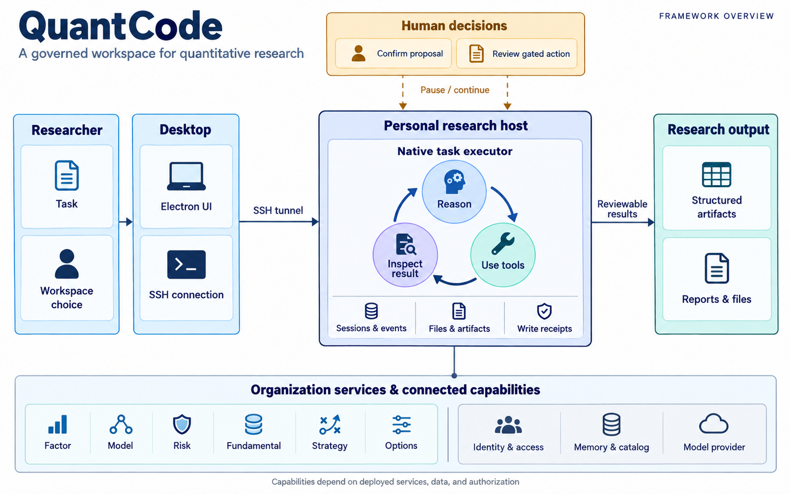
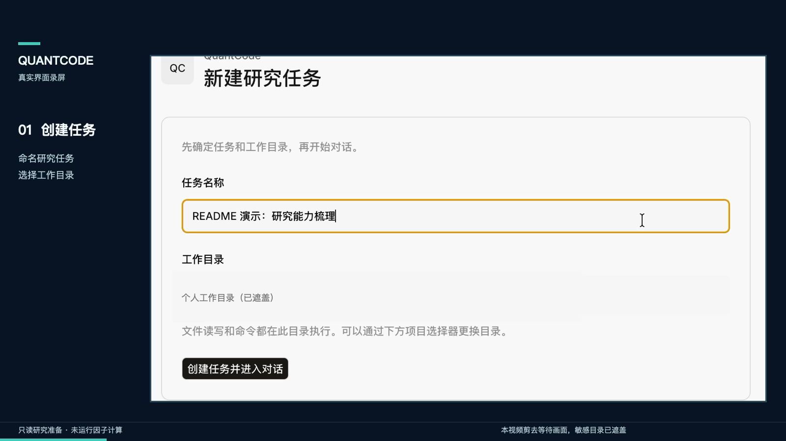
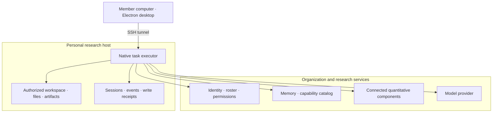
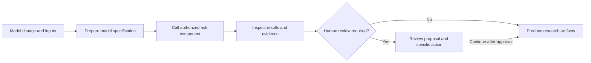

<div align="center">

# QuantCode

### An agent workspace for quantitative research teams

Organize research tasks, use tools, reuse knowledge, and review execution and artifacts within authorized workspaces.

[中文](./README.md) | **English**

[Demo video](#demo) · [Quick start](#quickstart) · [Architecture](#architecture) · [Tech stack](#stack) · [Research scenarios](#scenarios) · [Development](#development) · [FAQ](#faq)

[Source](https://github.com/HKUST-QUANT-SOCIETY/quantcode) · [Test release](https://github.com/HKUST-QUANT-SOCIETY/quantcode/releases/tag/quantcode-v1.2.0-test.5) · [Build history](https://github.com/HKUST-QUANT-SOCIETY/quantcode/actions/workflows/quantcode-desktop.yml) · [MIT License](LICENSE)

</div>



*The framework figure illustrates task execution. Component availability depends on services, data, and authorization; the deployment diagram below shows the boundaries.*

<a id="demo"></a>
## 🎬 Demo video

[](./assets/quantcode-task-workflow-demo.mp4)

[Watch the 14-second demo](./assets/quantcode-task-workflow-demo.mp4): create a research task, query the capability catalog and Memory, review the three-stage status table, and revisit the execution record.

<a id="introduction"></a>
## 📌 Introduction

Quantitative research involves moving between code, data, models, evaluation, and team knowledge. QuantCode places research tasks in workspaces with an identity, a working directory, and tool permissions. Through one desktop interface, members can request work, review a plan, execute tools, and inspect files and research artifacts.

The platform serves factor, model, risk, fundamental, strategy, and options teams, alongside infrastructure and agent groups. Connected components provide domain algorithms and data. QuantCode connects task context, capability discovery, approval, and execution records.

### What is included

- **Desktop workspace:** Task conversations, proposal panels, execution records, files, and artifacts.
- **Personal research hosts:** SSH access to organization-provisioned environments where tasks execute.
- **Organization identity and access:** Server-issued identities determine groups, roles, and workspaces.
- **Capability catalog and Memory:** Discover available tools and query authorized research knowledge.
- **Proposal and reuse review:** Inspect goals, acceptance criteria, and affected files before continuing operations that require approval.
- **Execution controls and records:** Workspace checks, budgets, stop controls, task history, and write receipts.
- **One repository:** UI, Electron desktop, native executor, and Python organization services live together.

### Where to start

| Your goal | Suggested path |
| --- | --- |
| Use an existing account | [Quick start](#quickstart) → [First task](#first-task) |
| Explore research capabilities | [Scenarios](#scenarios) → [Validation](#validation) |
| Contribute code | [Architecture](#architecture) → [Development](#development) |
| Manage an organization deployment | [Identity and review](#governance) → [Documentation](#docs) |

<a id="status"></a>
## 📦 Release and capability scope

The README in this snapshot points to **Test V1.2 / `1.2.0-test.5`**, an internal test prerelease. Test packages are not platform code-signed, and automatic updates are disabled.

| Area | Current scope |
| --- | --- |
| Desktop and tasks | SSH login, personal workspaces, organization models, native tasks, proposal review, budgets, and artifact access |
| Quantitative components | Factor evaluation, training, backtesting, risk, and valuation depend on connected services, data, and authorization |
| Deployment | Personal hosts and supporting services must be provisioned by the organization; installing the desktop does not create them |
| Production operations | Ordinary members cannot deploy to production |

Check the actual dependencies behind `UNAVAILABLE`, `PARTIAL`, and disconnected states. A tool appearing in the interface does not establish that its real business workflow is fully connected.

<details>
<summary><b>Recent Test V1.2 revisions</b></summary>

- `test.5`: Fixes SSH username persistence and workspace discovery, preserving confirmed server account choices.
- `test.4`: Adds Windows SSH Agent detection and enablement flow.
- `test.3`: Improves SSH entry, existing account mapping, and connection recovery.

See the [test.5 release notes](docs/releases/TEST_V1_2_5.md).

</details>

<a id="architecture"></a>
## 🧩 Architecture

### From desktop to research host



The member's computer provides the interface; the personal host executes research tasks. In the documented Test V1.2 deployment, a resident service on Server C handles identity, group Memory, task records, and artifacts. Connected components supply domain capabilities. You can reconnect after closing the desktop window to inspect server tasks; use the task's stop control to stop execution.

### Code responsibilities

| Location | Responsibility |
| --- | --- |
| `frontend/packages/app/` | Research workspace UI |
| `frontend/packages/desktop/` | Electron shell, SSH entry, and installers |
| `frontend/packages/opencode/`, `frontend/packages/core/` | Native executor, sessions, tools, and underlying execution capabilities |
| `frontend/packages/opencode/src/quantcode/` | Identity, workspaces, proposals, tool admission, budgets, artifacts, and write receipts |
| `quantcode/` | Python organization services and host interfaces |
| `runner/`, `tools/`, `schemas/` | Organization rules, knowledge/shared state, domain adapters, contracts, and historical compatibility code |

New tasks use the native execution path. Python continues to provide organization services and required compatibility functions. The presence of old `AgentRunner`, LangGraph, and checkpoint code does not mean new desktop tasks run a second independent Python reasoning loop.

<a id="stack"></a>
## ⚙️ Tech stack

| Layer | Technology in this repository | Role in QuantCode |
| --- | --- | --- |
| Desktop | Electron, TypeScript | Installer, native window, and desktop connection entry |
| Workspace UI | SolidJS, Vite, TypeScript | Task, proposal, file, and artifact interactions |
| Native host | Bun, TypeScript, Effect | Sessions, model calls, tool execution, and execution controls |
| Organization services | Python 3.12+, Pydantic | Identity, contracts, knowledge, and component adapters |
| Development tooling | Bun, `uv` | Frontend workspace and Python dependency management |

`pyproject.toml` still lists LangGraph and related dependencies for existing Python-side implementations and compatibility paths; that alone does not establish that LangGraph drives new tasks. Refer to `frontend/package.json` and `pyproject.toml` for version declarations.

<a id="quickstart"></a>
## 🚀 Quick start

### 1. Prepare access

An administrator must provision a personal research host, register the SSH public key and roster permissions, and configure the host connection descriptor. Members need the matching private key or an existing identity in their system SSH Agent.

Members using the desktop installer do not need to separately install Python, Bun, Node.js, or another OpenCode application on their computers.

### 2. Download the test package

Open the [Test V1.2 release](https://github.com/HKUST-QUANT-SOCIETY/quantcode/releases/tag/quantcode-v1.2.0-test.5) and download the package for your platform, together with `SHA256SUMS` and `release-manifest.json`.

| Platform | File |
| --- | --- |
| Mac · Apple Silicon | `quantcode-1.2.0-test.5-mac-arm64.dmg` |
| Mac · Intel | `quantcode-1.2.0-test.5-mac-x64.dmg` |
| Windows 10/11 · x64 | `quantcode-1.2.0-test.5-win-x64.exe` |

On Mac, drag the app to Applications. On Windows, follow the installer to install for the current user.

<details>
<summary><b>Download verification and platform prompts</b></summary>

macOS:

```bash
shasum -a 256 quantcode-1.2.0-test.5-mac-arm64.dmg
```

Windows PowerShell:

```powershell
Get-FileHash -Algorithm SHA256 .\quantcode-1.2.0-test.5-win-x64.exe
```

Compare the output with `SHA256SUMS`. Unsigned test packages may trigger Gatekeeper or SmartScreen; verify the source and checksum, then follow the platform instructions. See the [installation guide](frontend/packages/desktop/QUANTCODE_INSTALL.md).

</details>

### 3. Sign in and choose a workspace

1. Open the app. If no valid session exists, choose “重新登录” (Sign in again).
2. Select a registered SSH identity. Enter your existing server username if needed.
3. Choose an authorized group and its actual workspace server from the discovery results.
4. Confirm that the workspace and model are available, then create a task.

The host provides the organization test model. To use a personal provider, configure its URL, API key, and model in provider settings. Identity and model configuration are separate: adding a model does not grant additional workspace access.

<a id="first-task"></a>
## 💬 Complete your first task

Create a task in an authorized directory and enter:

> Inspect the current project structure, available capabilities, and group Memory. Propose a plan to create `hello_quantcode.md`, including its content, acceptance criteria, and affected files. Wait for my confirmation before writing. Afterward, read the file back and report its location.

### What to check

1. **Proposal:** The goal is clear, the file scope is correct, and completion can be assessed.
2. **Confirmation:** Review the current version in the “任务方案与能力复用” (Task proposal and capability reuse) panel, enter your review note, and continue execution.
3. **Execution:** Tool calls belong to the original task and files stay inside the authorized workspace.
4. **Acceptance:** The file exists, its contents meet the request, and the task record retains the result.

Open the original task from the task list to continue existing work. If a write receipt is unresolved, inspect the actual file or external evidence before deciding how to proceed; repeating the operation may repeat its side effects.

<a id="scenarios"></a>
## 🔬 Research scenarios and component integration

The following examples describe tasks that can be organized in each research area. What can actually execute depends on deployed components, data, and authorization.

| Area | Example task | Artifacts and dependencies to check |
| --- | --- | --- |
| Factor | Develop an idea, generate a specification, and request evaluation | Expression, data coverage, evaluation service, and result provenance |
| Model | Read model changes and extract structure and parameters | Model specification, version, and training/evaluation data |
| Risk | Analyze model or strategy risk and prepare review material | Metric inputs, thresholds, risk report, and review evidence |
| Fundamental | Retrieve sources, extract financial information, and produce a report | Sources, dates, valuation assumptions, and citations |
| Strategy | Combine signals, organize backtests, and compare results | Backtest engine, sample period, costs, and trading assumptions |
| Options | Organize volatility and Greeks analysis | Contract data, market timestamp, and model parameters |

### Example: model change to risk review



This is an illustrative workflow, not a run record from this work or a claim that all components are connected. A release demonstration should show inputs, configuration, actual tool responses, reports, and review records together.

<a id="governance"></a>
## 🔐 Identity, proposals, and execution controls

### Identity comes from the server

Accounts, groups, roles, and working directories follow organization registration. The tool catalog uses identity, role, and resource scopes to determine visibility. Prompts cannot change those grants.

### Approval belongs to a specific proposal

A proposal contains its goal, acceptance criteria, and file impact. The native proposal interface carries a document hash and version so approval for an earlier proposal is not applied to changed content. Review belongs to the host UI and should not be exposed as a model-callable tool.

### Writes need verifiable outcomes

The executor records write-started, write-completed, and reconciliation events. If a receipt is missing or inconsistent, the operation may already have happened while its outcome remains unconfirmed. Reconcile the original operation; a missing response does not establish that nothing executed.

<details>
<summary><b>Source reading guide</b></summary>

- [Proposals and version checks](frontend/packages/opencode/src/quantcode/solution.ts)
- [Tool catalog and admission](frontend/packages/opencode/src/quantcode/tool-catalog.ts)
- [Write receipts and reconciliation](frontend/packages/opencode/src/quantcode/write-receipt.ts)

</details>

<a id="knowledge"></a>
## 🧠 Memory, shared state, and history

| Concept | Purpose | Usage note |
| --- | --- | --- |
| Memory | Query authorized research knowledge | Empty results and disconnected services are different states |
| Capability catalog | Discover published capabilities available to the current identity | Visibility must match execution admission |
| Blackboard | Persist shared state for organization workflows | Sharing scope requires explicit control |
| Sessions and events | Record task activity, artifacts, and write outcomes | New tasks use the native execution mechanism |
| Historical checkpoints | Support compatibility with older execution paths | Old tasks must not silently rerun as new tasks |

The source also contains interfaces for generating and reviewing knowledge candidates, subject to host configuration. Task output is not automatically equivalent to reviewed, published team knowledge.

<a id="development"></a>
## 🛠️ Development

### Prerequisites

- Git; Python **3.12+** and `uv`.
- Bun: the repository declares package manager version **1.3.14**.
- Desktop builds require the relevant platform environment; consult the packaging and signing documentation.

### Install and start

```bash
git clone https://github.com/HKUST-QUANT-SOCIETY/quantcode.git
cd quantcode
uv sync --extra dev
bun run install:frontend
bun run dev:quantcode
```

Electron development entry point:

```bash
bun run dev:desktop
```

Only this repository is needed. The research host still requires an organization gateway, roster, public keys, workspaces, and a reviewed tool catalog. Starting a development server does not grant organization membership.

<details>
<summary><b>Ports and build entry points</b></summary>

Default ports are `4096` for the backend and `4444` for the web app. Use separate ports if they are occupied:

```bash
QUANTCODE_BACKEND_PORT=4196 QUANTCODE_APP_PORT=4544 bun run dev:quantcode
```

Build the web app, desktop code, or an installer for the current platform:

```bash
bun run build:web
bun run build:desktop
bun run package:desktop
```

These are separate entry points. Producing an installer does not establish cross-platform validation or platform signing.

</details>

### Repository map

```text
quantcode/
├── frontend/packages/
│   ├── app/             Research workspace UI
│   ├── desktop/         Electron and installers
│   ├── opencode/        Native host and task execution
│   └── core/            Shared execution capabilities
├── quantcode/           Python organization services
├── runner/              Rules, knowledge, shared state, compatibility
├── tools/               Tools and component adapters
├── schemas/             Data contracts
├── tests/               Python tests
├── scripts/             Development, deployment, and checks
├── docs/                Design, releases, and validation records
└── specs/               Functional specifications
```

<a id="validation"></a>
## 🧪 Testing and result validation

Python tests:

```bash
.venv/bin/pytest -q
```

Native executor type checks and tests:

```bash
cd frontend/packages/opencode
bun typecheck
bun --smol test --timeout 30000
```

When validating a research task, also record:

- The commit, configuration, data version, and execution identity.
- Whether tools called real services or returned mock, fallback, or unavailable results.
- Artifact locations, key contents, and whether acceptance criteria were met.
- Whether review applied to the correct version and task state matched receipts after reconnection.

Passing tests and having a particular real business service connected require separate verification.

<a id="faq"></a>
## ❓ FAQ

<details>
<summary><b>Can the desktop run independently as soon as it is installed?</b></summary>

The documented deployment uses personal research hosts and organization services. Installing the desktop must be followed by access through a valid organization setup.

</details>

<details>
<summary><b>Do I need my own model API key?</b></summary>

The organization test environment provides a model, so ordinary members usually do not need to enter a key. Configure the model settings fields if using a personal provider.

</details>

<details>
<summary><b>What if I can sign in but see the wrong group or tools?</b></summary>

Check the actual server, username, and public key. Ask an administrator to verify the roster and capability catalog. Conversation text cannot change identity or tool authorization.

</details>

<details>
<summary><b>Why has execution not continued after proposal confirmation?</b></summary>

Use “继续执行” (Continue execution) in the proposal panel and check the budget, approval version, and error message. Reconcile the original operation first if a write outcome is unknown.

</details>

<details>
<summary><b>Does this provide fully automated quantitative trading?</b></summary>

This version provides a research workspace and controlled execution capabilities. Data, evaluation, training, backtesting, and risk services need their own integrations. Complete real-data workflows are not promised for every scenario, and ordinary members cannot deploy to production.

</details>

<a id="docs"></a>
## 📚 Documentation

| Topic | Document |
| --- | --- |
| Product goals | [PRD](docs/PRD.md) |
| Features and permissions | [Functional specification](specs/FUNCTIONAL_SPEC.md) |
| Technical design | [QuantCode Design](docs/QuantCode_Design.md) |
| Login and workspaces | [Login flow](docs/LOGIN_FLOW.md) |
| Administrator entry | [Admin login](docs/ADMIN_LOGIN.md) |
| Monorepo development | [Repository layout](docs/REPOSITORY_LAYOUT.md) |
| Packaging and releases | [Release guide](frontend/packages/desktop/QUANTCODE_RELEASE.md) |

<a id="contributing"></a>
## 🤝 Contributing

Report problems through [Issues](https://github.com/HKUST-QUANT-SOCIETY/quantcode/issues) or propose improvements through [Pull Requests](https://github.com/HKUST-QUANT-SOCIETY/quantcode/pulls).

Include the version, platform, reproduction steps, and expected and actual behavior in a report. For login or tool-access problems, include redacted error details. Code changes should describe affected modules and validation. Keep the Chinese and English README content and navigation synchronized when updating documentation.

<a id="license"></a>
## ⚖️ License and origins

QuantCode is maintained by **HKUST QUANT SOCIETY** under the [MIT License](LICENSE). The desktop and executor build on OpenCode-origin source maintained in this repository. Parts of the Memory, Checkpoint, and Subagent design draw on MimoCode. Upstream copyright, dependency declarations, and third-party notices are retained.

---

[中文](./README.md) | **English** · [Back to top](#quantcode)
